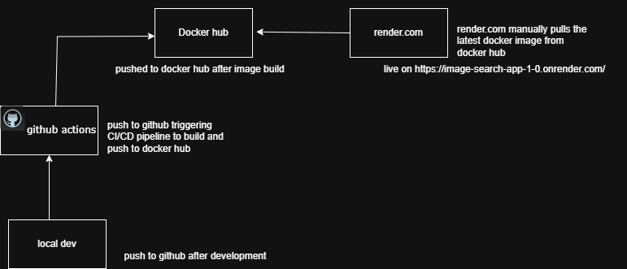

# API image search App 🏅

-Fetches images and description from unsplash.com API and displays them in cards. 

-Project is live free hosted on onrender.com with address [https://image-search-app-1-0.onrender.com/](https://image-search-app-1-0.onrender.com/)

## System requirements

-For successful usage of this project, the system requirements are:

1. **Nodejs**:
 - Go to [https://nodejs.org/en/download](https://nodejs.org/en/download) to download and choose for your operating system.

2. **Docker**:
 - For Windows download make sure you have enabled WSL (Windows Subsystem for Linux) or Hyper-V. To download [https://docs.docker.com/desktop/setup/install/windows-install/](https://docs.docker.com/desktop/setup/install/windows-install/)

 - For Mac, Docker stoped supporting the oldest version and supports the newest version of macOS (in addition to the previous two releases). And have at least 4GB RAM. Read documentation for more information here before download [https://docs.docker.com/desktop/setup/install/mac-install/](https://docs.docker.com/desktop/setup/install/mac-install/)

  - For Linux download, read the documentation before download for different distributions on [https://docs.docker.com/desktop/setup/install/linux/](https://docs.docker.com/desktop/setup/install/linux/)

### To run the App
 - To build the docker image:
   ```
   docker build -t myapp . 
   ```

- To run the docker image as a container and access it on localhost 8080 on the brouser:

  **NOTE:** *If port 8080 is already in use in your computer, then use 8081:8080 or another port on the docker run command to access port container 8080 on the brouser*
   ```
   docker run -d -p 8080:8080  myapp                                                                       
   ```
   
## CI/CD Pipeline

- GitHub Actions builds docker image and automatically pushes to docker.com where it is manually pulled on render.com  [image-search-app-1-0.onrender.com](image-search-app-1-0.onrender.com) for release to public.

<!-- ci-cd-diagram -->

<!-- end-ci-cd-diagram -->
### SBOM.

-All **third party** software used in this project, **Dependancies** are 9 and **devDependancies** are 19:

**Dependancies**:
1. assert: ^2.1.0
2. async-hooks: ^1.3.1
3. browserify-zlib: ^0.2.0
4. crypto-browserify: ^3.12.1
5. express: ^4.22.0
6. querystring-es3: ^0.2.1
7. stream-http: ^3.2.0
8. vm-browserify: ^1.1.2
9. webpack: ^5.104.1        


**devDependencies**: 
1. @babel/core: ^7.26.10
2. @babel/preset-env: ^7.26.9
3. babel-jest: ^29.7.0
4. babel-loader: ^10.0.0
5. buffer: ^6.0.3
6. copy-webpack-plugin: ^13.0.0
7. cross-env: ^7.0.3
8. css-loader: ^7.1.2
9. html-webpack-plugin: ^5.6.3
10. jest: ^29.7.0
11. mini-css-extract-plugin: ^2.9.2
12. nodemon: ^3.1.9
13. path-browserify: ^1.0.1
14. stream-browserify: ^3.0.0
15. string_decoder: ^1.3.0
16. style-loader: ^4.0.0
17. url: ^0.11.4
18. util: ^0.12.5
19. webpack-cli: ^6.0.1


*Author: Moka Austine*

DevOps Engineer♾️